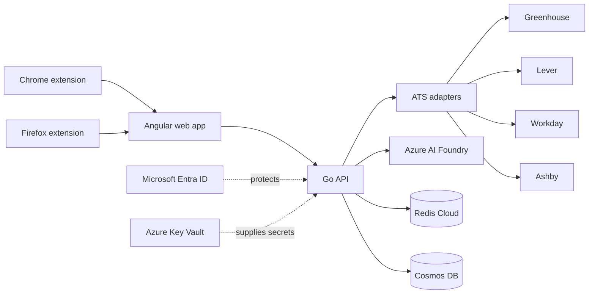

# Job Application Assistant

A private, single-user workspace for turning public job postings into reviewed, tailored cover letters.

Paste a Greenhouse, Lever, Workday, or Ashby URL—or paste the job description manually—and the application normalizes the posting, compares it with a stored resume profile, generates a draft through Azure AI Foundry, and keeps a versioned application history.

> **Project status:** ATS ingestion, profile storage, AI drafting, caching, persistence, application tracking, browser URL capture, and Entra-aware API protection are implemented. Gmail draft creation is deliberately not implemented yet.

## Features

- Public JSON integrations for Greenhouse, Lever, Workday, and Ashby
- Manual job-description fallback for unsupported career sites
- Resume and background profile with content-based versioning
- Model-swappable cover-letter drafting through Azure AI Foundry
- Fit summary alongside every generated cover letter
- Durable applications and versioned drafts in Azure Cosmos DB
- Redis caching for job postings and generated drafts
- In-memory persistence and no-op caching for simple local development
- Application status tracking: drafting, applied, interviewing, rejected, and offer
- Chrome and Firefox extensions that capture only the active tab URL
- Azure Container Apps authentication with optional single-principal enforcement
- Managed identity support for Cosmos DB and Azure AI Foundry

## Architecture



The Go service separates HTTP handlers, application workflows, provider adapters, cache access, and persistence. User-supplied URLs are parsed into provider identifiers; the backend then calls a known ATS API host instead of requesting arbitrary hosts.

Redis contains only disposable data. Profiles, job snapshots, application records, and draft versions belong in Cosmos DB.

See [docs/architecture.md](docs/architecture.md) for the package boundaries and data ownership rules.

## Technology

| Area | Implementation |
|---|---|
| Web application | Angular 21, TypeScript |
| API | Go 1.24, standard `net/http` router |
| AI drafting | Azure AI Foundry OpenAI-compatible v1 API |
| Persistence | Azure Cosmos DB |
| Cache | Redis Cloud / Redis |
| Authentication | Microsoft Entra ID through Azure Container Apps authentication |
| Secrets | Azure Key Vault references and managed identity |
| Hosting | Azure Container Apps |
| Browser capture | Shared Chrome and Firefox extension source |
| Infrastructure | Bicep |

## Repository structure

```text
.
├── apps
│   ├── api
│   │   ├── cmd/api                 # Composition root and HTTP server
│   │   └── internal
│   │       ├── ats                 # Dispatcher and provider adapters
│   │       ├── auth                # Container Apps identity enforcement
│   │       ├── cache               # Redis and no-op cache stores
│   │       ├── domain              # Profiles, jobs, drafts, applications
│   │       ├── drafting            # Azure AI Foundry client
│   │       ├── httpapi             # REST handlers
│   │       ├── repository          # Cosmos and memory repositories
│   │       └── service             # Application workflows
│   └── web                         # Angular frontend
├── extensions
│   ├── shared                      # Shared extension popup
│   ├── chrome                      # Chrome manifest
│   └── firefox                     # Firefox manifest
├── infra/bicep                     # Azure deployment definitions
├── docs                            # Architecture notes
└── compose.yaml                    # Local disposable Redis
```

## Local development

### Requirements

- Go 1.24 or newer
- Node.js 22 or newer
- npm
- Docker with Compose, if you want Redis locally

### 1. Configure the API

```bash
cp .env.example .env
```

The example configuration starts with local authentication disabled, local Redis enabled, and in-memory persistence. Draft generation remains disabled until Azure AI Foundry values are supplied.

Start Redis and load the environment:

```bash
docker compose up -d redis
set -a
source .env
set +a
```

The API does not automatically read `.env`; the shell commands above export it for the current terminal.

### 2. Start the API

```bash
make api
```

The API listens on `http://localhost:8080` by default.

If Redis is omitted or unavailable, the API continues with a no-op cache. If Cosmos DB is omitted, it uses an in-memory repository whose data lasts until the process stops.

### 3. Start the frontend

In a second terminal:

```bash
cd apps/web
npm ci
npm start
```

Open `http://localhost:4200`. The Angular development server proxies `/api` requests to the Go service.

## Configuration

| Variable | Required | Purpose |
|---|---:|---|
| `HTTP_ADDR` | No | API listen address; defaults to `:8080` |
| `WEB_ORIGIN` | No | Allowed browser origin; defaults to `http://localhost:4200` |
| `APP_USER_ID` | No | Fixed persistence identity for the single user |
| `REDIS_URL` | No | Redis or Redis Cloud connection URL |
| `AZURE_COSMOS_ENDPOINT` | Production | Cosmos endpoint used with managed identity |
| `AZURE_COSMOS_CONNECTION_STRING` | Local alternative | Cosmos connection string; takes precedence over the endpoint |
| `COSMOS_DATABASE` | No | Database name; defaults to `job-application-assistant` |
| `AZURE_AI_ENDPOINT` | Drafting | Azure AI Foundry resource endpoint |
| `AZURE_AI_DEPLOYMENT` | Drafting | Foundry model deployment name |
| `AZURE_AI_API_KEY` | Local alternative | API key; when absent, Foundry uses managed identity |
| `REQUIRE_ENTRA_AUTH` | Production | Requires the Container Apps identity header when `true` |
| `ALLOWED_ENTRA_PRINCIPAL_ID` | No | Restricts the API to one Entra principal object ID |

Production secrets should be referenced from Azure Key Vault. Do not commit a populated `.env` file.

## API

All request and response bodies use JSON.

| Method | Path | Purpose |
|---|---|---|
| `GET` | `/healthz` | Service health check |
| `POST` | `/api/v1/jobs/resolve` | Resolve an ATS URL or normalize manually pasted text |
| `GET` | `/api/v1/profile` | Read the candidate profile |
| `PUT` | `/api/v1/profile` | Save resume and background text |
| `POST` | `/api/v1/drafts` | Generate and persist a cover-letter draft |
| `GET` | `/api/v1/applications` | List application history |
| `PATCH` | `/api/v1/applications/{id}` | Change an application status |
| `GET` | `/api/v1/applications/{id}/drafts` | List stored draft versions |

Resolve a public posting:

```bash
curl -X POST http://localhost:8080/api/v1/jobs/resolve \
  -H 'Content-Type: application/json' \
  -d '{"url":"https://jobs.lever.co/example/job-id"}'
```

Use the manual fallback:

```bash
curl -X POST http://localhost:8080/api/v1/jobs/resolve \
  -H 'Content-Type: application/json' \
  -d '{
    "title":"Backend Engineer",
    "company":"Example Company",
    "description":"Build reliable services in Go."
  }'
```

Save a candidate profile:

```bash
curl -X PUT http://localhost:8080/api/v1/profile \
  -H 'Content-Type: application/json' \
  -d '{
    "resumeText":"Your resume in plain text",
    "background":"Optional context that is not in the resume"
  }'
```

Draft generation accepts the normalized `JobPosting` returned by the resolve endpoint:

```json
{
  "posting": {
    "source": "manual",
    "title": "Backend Engineer",
    "company": "Example Company",
    "description": "Build reliable services in Go."
  }
}
```

## ATS support

| Source | Public URL support | Backend access |
|---|---:|---|
| Greenhouse | Yes | Job Board API |
| Lever | Yes | Postings API |
| Workday | Yes | Public CXS job response |
| Ashby | Yes | Public job-board API |
| iCIMS and custom sites | Manual fallback | No scraping |

The adapters do not scrape LinkedIn or automate LinkedIn in any way.

## Browser extensions

Build both unpacked extensions:

```bash
cd extensions
npm run build
```

This produces `extensions/dist/chrome` and `extensions/dist/firefox`. Load the appropriate directory as an unpacked or temporary extension.

The extension reads the active tab URL only after the user clicks its button. It has no content script and does not read page DOM content. Before packaging for deployment, change `workspaceUrl` in `extensions/shared/src/popup.js` to the hosted frontend URL.

## Tests and validation

Run the backend tests and static checks:

```bash
cd apps/api
go test ./...
go vet ./...
```

The backend suite covers ATS response normalization, Foundry request/response handling, application persistence, status changes, and draft history.

Build the frontend:

```bash
cd apps/web
npm ci
npm run build
```

Build and validate extension packages:

```bash
cd extensions
npm run build
```

GitHub Actions runs the Go tests and Angular production build for pushes and pull requests to `main`.

## Azure deployment

The Bicep deployment creates:

- Cosmos DB with `applications`, `drafts`, and `profile` containers
- Azure Key Vault
- An Azure Container Apps environment and API container
- Managed-identity access to Cosmos DB
- Optional Key Vault access for the Redis Cloud URL
- Container Apps authentication configured for an Entra app registration

The deployment expects an existing container image, Entra app registration, Azure AI Foundry deployment, and Redis Cloud database.

```bash
az deployment group create \
  --resource-group YOUR_RESOURCE_GROUP \
  --template-file infra/bicep/main.bicep \
  --parameters \
    namePrefix=YOUR_PREFIX \
    apiImage=YOUR_REGISTRY/YOUR_API_IMAGE:TAG \
    entraClientId=YOUR_ENTRA_CLIENT_ID \
    allowedPrincipalId=YOUR_USER_OBJECT_ID \
    aiEndpoint=YOUR_FOUNDRY_ENDPOINT \
    aiDeployment=YOUR_MODEL_DEPLOYMENT \
    redisSecretUri=YOUR_KEY_VAULT_SECRET_URI
```

Grant the Container App managed identity permission to invoke the selected Foundry deployment as part of environment setup.

## Security model

- The project is designed for one user rather than public multi-tenant access.
- Azure Container Apps authentication rejects unauthenticated production requests.
- The backend can restrict requests to one Entra principal ID.
- Managed identity avoids long-lived Cosmos and Foundry credentials in production.
- Redis stores only rebuildable cache entries.
- Cosmos DB stores authoritative application and draft data.
- ATS adapters construct requests to known provider hosts, limiting server-side request forgery exposure.
- Cover letters are always presented for human review.
- Automated email sending and LinkedIn automation are outside the project scope.

## Roadmap

- [x] Go API and ATS adapter layer
- [x] Angular capture and review workflow
- [x] Azure AI Foundry drafting
- [x] Cosmos DB persistence
- [x] Redis caching
- [x] Chrome and Firefox URL capture
- [x] Entra-aware API protection and Bicep infrastructure
- [ ] Gmail draft creation with `gmail.compose` scope
- [ ] Application history UI
- [ ] Optional observability and deployment automation

Gmail support, when added, will create drafts only. Sending will remain a manual action in Gmail.
